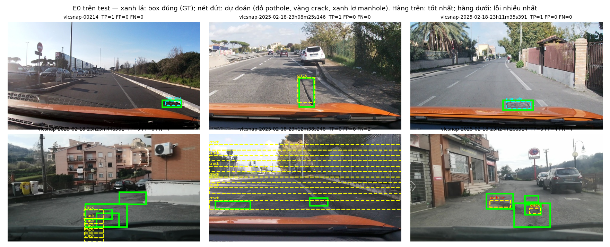
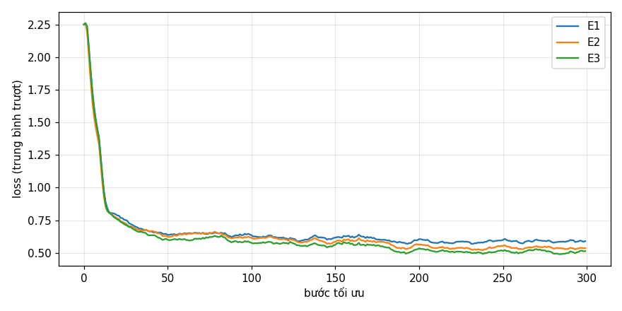
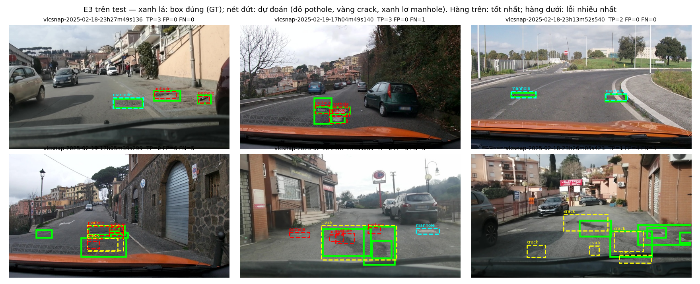
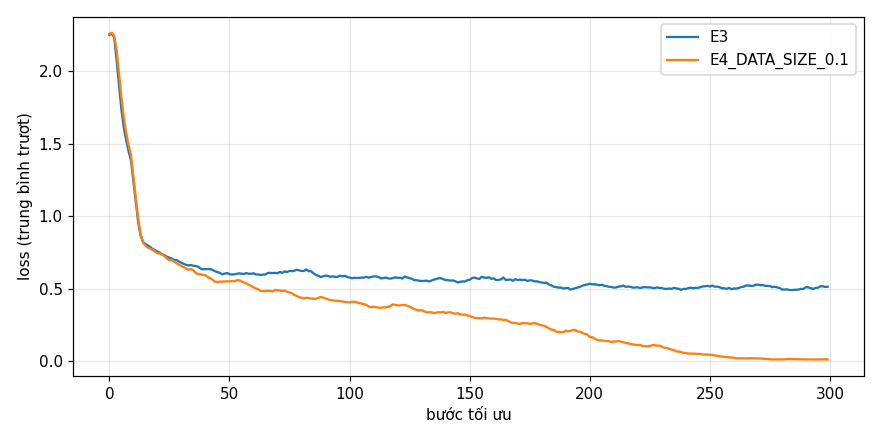
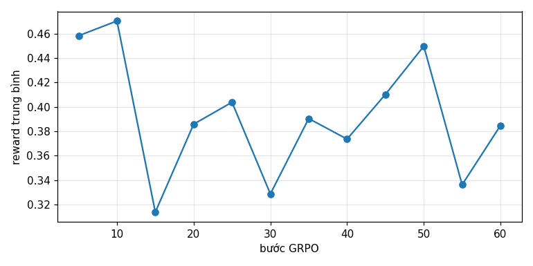

Họ tên: Đinh Lệnh Tiến Anh
`dataset_version`: d10-21e4070301

> Toàn bộ số liệu lấy từ một lần chạy notebook `lab_day10.ipynb` trên **Kaggle, 1× Tesla T4** (tổng 5,68 giờ), chấm trên **test (311 ảnh)** bằng `scripts/score.py`. Số liệu bổ sung (bootstrap ghép cặp, chấm lệch thang, rò rỉ khi chia ngẫu nhiên, kích thước box) tính lại bằng `python report/analysis.py` từ đúng các file dự đoán `work/*.jsonl` của lần chạy đó.

## Bảng tổng hợp (số của bạn, lấy từ `report/evidence/*.json`)

| Mã | Setup | Tham số huấn luyện | VRAM đỉnh (GB) | Phút | F1 | CI95 | FP/ảnh | F1 pothole | F1 crack | F1 manhole |
|---|---|---|---|---|---|---|---|---|---|---|
| E0 | zero-shot | 0 | 3,51 (chỉ nạp model) | 0 (suy luận 18,5) | 0,082 | 0,059–0,107 | 0,98 | 0,111 | 0,023 | 0,186 |
| E1 | LoRA LLM | 33 030 144 | 7,01 | 48,1 | 0,256 | 0,223–0,295 | 1,27 | 0,132 | 0,182 | 0,545 |
| E2 | + projector | 142 135 296 | 8,82 | 48,7 | 0,325 | 0,288–0,364 | 1,16 | 0,195 | 0,241 | 0,616 |
| E3 | + LoRA ViT | 148 426 752 | 9,02 | 56,8 | **0,394** | 0,350–0,438 | 0,97 | 0,282 | 0,306 | 0,664 |
| E4 | `data_size` = 0,1 (setup E3, 142 ảnh) | 148 426 752 | 8,43 | 56,1 | 0,308 | 0,272–0,345 | 1,66 | 0,199 | 0,223 | 0,604 |
| E4 | `data_size` = 1,0 (= E3, 1 422 ảnh) | 148 426 752 | 9,02 | 56,8 | 0,394 | 0,350–0,438 | 0,97 | 0,282 | 0,306 | 0,664 |
| E5 | GRPO 60 bước, khởi tạo từ E3 | 39 321 600 | 6,79 | 52,9 | 0,402 | 0,358–0,448 | 0,95 | 0,271 | 0,295 | 0,702 |

Mọi setup huấn luyện: QLoRA NF4, r = 16, α = 32, dropout 0,05, AdamW lr 2e-4 (warmup 5% + cosine), batch 2 × tích luỹ 4, 300 bước, seed 42. Thời gian suy luận trên test: E0 18,5 phút, E1 11,1, E2 10,5, E3 10,8, E4(0,1) 12,0, E5 10,7. `parse_valid_rate`: E0 0,804; E1 0,997; E2 1,000; E3 0,997; E4(0,1) 1,000; E5 0,997.

## 10 câu hỏi (trả lời bằng **số của bạn**, không chép lại tài liệu)

### Câu 1 — Kiến trúc: ViT, projector và LLM của Qwen3-VL-4B có bao nhiêu tham số mỗi khối, và E1/E2/E3 mỗi cái cập nhật khối nào?

Đếm trên model "meta" (chỉ có hình dạng) bằng `named_parameters()`:

| Khối | Tham số | Lưu trữ khi huấn luyện |
|---|---|---|
| ViT `model.visual` (tổng) | 415,3M | fp16, **không** lượng tử hoá |
| ↳ 24 block ViT + patch embed | ≈ 306,2M | fp16 |
| ↳ projector `visual.merger` | 27,3M | fp16 → fp32 khi huấn luyện (E2/E3) |
| ↳ projector `visual.deepstack_merger_list` (3 merger cho đặc trưng lớp 5/11/17) | 81,8M | như trên |
| LLM + embedding `model.language_model` | 4 022,5M | 4-bit NF4 (embedding fp16) |
| `lm_head` | dùng chung trọng số embedding | fp16 |
| **Tổng** | **4 437,8M** | |

- **E1** chỉ cập nhật **LoRA trên LLM**: 252 module (36 lớp × q/k/v/o/gate/up/down) → 33,03M tham số (0,74% model). ViT và projector đóng băng.
- **E2** = E1 + **huấn luyện đầy đủ projector** (merger + deepstack, 109,11M tham số, fp32) → 142,14M; đúng bằng E1 + 109,11M.
- **E3** = E2 + **LoRA trên ViT**: thêm 96 module (24 block × `attn.qkv`, `attn.proj`, `mlp.linear_fc1`, `mlp.linear_fc2`), tổng 348 module LoRA → 148,43M (ViT LoRA thêm 6,29M).

Ở cả ba setup, trọng số gốc của LLM và ViT **không đổi**; LoRA chỉ học phần cập nhật hạng thấp ΔW = BA cộng vào. Notebook `assert` đúng 252/348 module và kiểm tra ViT/projector là `nn.Linear` (không bị lượng tử hoá) còn LLM thì có.

### Câu 2 — E0: `parse_valid_rate` bằng bao nhiêu, và hai lỗi phổ biến nhất của model gốc là gì (kèm một ví dụ output thô)?

`parse_valid_rate` = **0,804** (250/311 ảnh hợp lệ, 61 hỏng). Model gốc **không** mắc lỗi định dạng kiểu khác: 0/311 câu bọc ```json, 0/344 box có toạ độ > 1000, 0 nhãn ngoài 3 lớp. Tức là nó đã quen thang 0–1000 và hiểu prompt. Hai lỗi chính:

1. **Lặp vô hạn → bị cắt ở 256 token → JSON hỏng.** 56/61 output hỏng không có dấu `]` đóng. Model liệt kê một "lưới" box `crack` với toạ độ tăng đều cho tới khi hết `max_new_tokens`. Ngay cả trong các output hợp lệ, 40/230 câu trả lời không rỗng chứa box **trùng hệt nhau**. Ví dụ thô (`vlcsnap-2025-02-18-23h12m38s248`, ô giữa hàng dưới của `pred_e0.png`):
   ```
   [{"label": "crack", "bbox_2d": [0, 620, 1000, 700]}, {"label": "crack", "bbox_2d": [0, 500, 1000, 550]},
    {"label": "crack", "bbox_2d": [0, 400, 1000, 450]}, {"label": "crack", "bbox_2d": [0, 300, 1000, 350]}, ...
   ```
   (các dải ngang phủ cả khung hình, kể cả bầu trời).
2. **Bịa box / sai vị trí, nặng nhất ở lớp crack.** E0 dự đoán 226 box `crack` nhưng chỉ 6 box đúng (P = 0,027, R = 0,020). Toàn bộ: TP = 38, FP = 306, FN = 545 → P = 0,110, R = 0,065. Model cũng đếm thiếu (1,38 box/ảnh hợp lệ so với 1,87 thật). Box nào khớp thì khá chuẩn (mean IoU 0,622), nên vấn đề là **phát hiện sai cái gì**, không phải thang toạ độ.



### Câu 3 — Thang 0–1000: nếu chấm output theo pixel (hoặc ngược lại) thì F1 ra sao và vì sao? Bạn đã kiểm chứng điều này thế nào?

**F1 sụp về 0.** Kiểm chứng bằng cách chấm lại đúng file dự đoán với `evaluate(..., coord="pixel")` của `score.py` (`report/analysis.py`):

| Dự đoán | chấm `norm1000` | chấm như `pixel` |
|---|---|---|
| E0 | 0,082 | **0,000** |
| E3 | 0,394 | **0,000** |
| Đáp án đúng (GT) viết theo 0–1000 | 1,000 | **0,000** |
| Đáp án đúng (GT) viết theo pixel | **0,000** | 1,000 |

Lý do: chấm như pixel nghĩa là lấy x × 1000/640 (giãn 1,56 lần) và y × 1000/360 (giãn 2,78 lần). Ví dụ box pothole `[480, 472, 544, 533]` (0–1000) bị hiểu thành `[750, 1311, 850, 1481]`, nằm hẳn ra ngoài ảnh theo trục y. Box ở đây rất nhỏ (trung vị 0,4–2% diện tích ảnh), nên chỉ lệch vài phần trăm là IoU < 0,5. Với phép biến đổi giãn 1,56 × 2,78 thì **không box nào** còn khớp, kể cả với đáp án hoàn hảo. Vì vậy "F1 ≈ 0 mà JSON hợp lệ" là triệu chứng điển hình của lệch thang.

Vì sao Qwen3-VL dùng 0–1000: ảnh được đổi kích thước động trước khi vào ViT (640×360 → lưới 20×11 = 220 token, mỗi token phủ 32×32 px), nên model không "biết" kích thước pixel gốc. Toạ độ tương đối thì không phụ thuộc độ phân giải và trùng định dạng grounding lúc tiền huấn luyện. E0 cho thấy điều đó: 0/344 box vượt 1000 dù không được dạy.

Ở phía nhãn, notebook kiểm chứng hai chiều: (1) quy JSON 0–1000 ngược về pixel và so với box YOLO gốc, sai số lớn nhất **0,32 px** (chỉ do làm tròn), vẽ chồng lên ảnh để kiểm tra bằng mắt; (2) mọi đáp án của cả 3 split, ở cả hai thang, đều qua `parse_output` và giữ nguyên số box. Box quá nhỏ (x2 ≤ x1 sau khi làm tròn) được nới thành rộng 1 đơn vị, vì nếu không `parse_output` loại **cả** câu trả lời.

### Câu 4 — Mask loss: vì sao chỉ tính loss trên phần trả lời? Điều gì xảy ra nếu tính trên cả prompt và token ảnh?

Lúc suy luận, model **được cho** ảnh và prompt, chỉ phải **sinh** phần trả lời. Loss cần đo đúng việc đó: −log p(đáp án | ảnh, prompt). Trong dữ liệu của tôi, ví dụ `train[0]` dài 608 token, gồm **220 token ảnh** + 139 token prompt/chat template + 249 token đáp án (9 box, tính cả `<|im_end|>`). Đáp án trung vị chỉ **57 token**, nên thường ~86% chuỗi là prompt + ảnh. Notebook đặt `labels = -100` cho mọi vị trí trước đáp án và cả `"\n"` sau `<|im_end|>`, rồi kiểm tra bằng cách giải mã riêng phần `labels != -100`: kết quả đúng là JSON đáp án + `<|im_end|>`.

Nếu tính loss trên cả chuỗi:
- **Token ảnh** chỉ là 220 placeholder `<|image_pad|>` giống hệt nhau (nội dung thật đi qua `pixel_values`). Đoán chúng là việc tầm thường: loss giảm nhanh nhưng không học gì, và chúng chiếm phần lớn mẫu số của loss trung bình.
- **Prompt** giống hệt nhau ở mọi ví dụ: model tốn dung lượng LoRA học thuộc câu lệnh, và gradient của phần box bị pha loãng còn ~14% (57/416 token). Thực chất learning rate cho đúng phần cần học nhỏ đi nhiều lần.
- Model còn học **sinh cả lượt user**, dễ không dừng đúng chỗ. Ngược lại, việc giữ `<|im_end|>` trong labels dạy model biết dừng: `parse_valid_rate` tăng từ 0,804 (E0) lên 0,997–1,000 (E1–E3), và loss bước 1 là 2,25 giảm còn ≈ 0,5–0,6.

### Câu 5 — Vì sao không thể huấn luyện đầy đủ projector nếu ViT bị lượng tử hoá 4-bit, và bạn đã xử lý thế nào? Vì sao projector phải ở float32?

**Vì sao không được lượng tử hoá:** khi lượng tử hoá 4-bit, `nn.Linear` bị thay bằng `bnb.Linear4bit`. Trọng số lúc đó là các số 4-bit nén trong tensor `uint8` (`Params4bit`) kèm hệ số scale, không phải tensor số thực, nên không có gradient và không cập nhật trực tiếp được. Với lớp 4-bit chỉ có thể gắn LoRA bên cạnh. Ngoài ra, dù có giải lượng tử để cập nhật thì mỗi lần ghi lại đều làm tròn về 16 mức NF4, xoá mất cập nhật nhỏ. Muốn huấn luyện **đầy đủ** merger thì trọng số phải là số thực.

**Cách xử lý:** `BitsAndBytesConfig(..., llm_int8_skip_modules=["model.visual", "lm_head"])` giữ toàn bộ ViT (gồm cả merger/deepstack) và `lm_head` ở fp16. Tôi gặp một bẫy: ở transformers 5.x, mẫu skip được so khớp **từ đầu tên module**, nên ghi `"visual"` như pseudo code thì ViT **vẫn bị lượng tử hoá**. Phải ghi `"model.visual"`. Hàm `load_base()` `assert` rằng `visual.blocks[0].attn.qkv` và `visual.merger.linear_fc1` là `torch.nn.Linear`, còn `language_model.layers[0].mlp.up_proj` thì không.

**Vì sao fp32:**
- (1) Cập nhật của AdamW ≈ lr = 2e-4 (tương đối với trọng số). fp16 chỉ có 10 bit mantissa: quanh giá trị 1,0 khoảng cách giữa hai số fp16 liền nhau là ~9,8e-4, nên cập nhật 2e-4 bị **làm tròn mất** và projector gần như đứng yên.
- (2) `GradScaler.unscale_` báo lỗi "Attempting to unscale FP16 gradients": AMP cần master weight fp32.
- (3) Moment bậc hai của Adam (bình phương gradient) dễ underflow trong fp16.

Forward vẫn chạy fp16 nhờ `autocast`, chỉ bản gốc của trọng số và optimizer state là fp32. Giá phải trả khớp đo đạc: 109,1M × (4 B trọng số + 4 B gradient + 8 B Adam) ≈ 1,75 GB, còn VRAM đỉnh đo được tăng **7,01 → 8,82 GB (+1,81 GB)** từ E1 lên E2. Projector đã huấn luyện được lưu riêng vào `projector.pt` (peft chỉ lưu LoRA) và nạp lại lúc suy luận ("nạp lại 24 tensor projector (109,1M tham số)" trong log). Nếu quên bước này thì E2 sẽ trông giống E1.

### Câu 6 — Split theo phiên quay: vì sao chia ngẫu nhiên sẽ cho F1 cao giả? Số ảnh và số box từng lớp ở mỗi split là bao nhiêu?

Ảnh là frame cắt từ **18 phiên quay** (3–475 ảnh/phiên, trung vị 57,5). Hai frame liền kề gần như trùng nhau: trên ảnh thu nhỏ 64×36, sai khác điểm ảnh trung vị chỉ **27,6** (thang 0–255), so với **57,5** giữa hai ảnh ngẫu nhiên. Tôi mô phỏng chia ngẫu nhiên cùng kích thước train/test (20 seed): **91,0%** ảnh test (87,1–93,9%) có frame liền kề nằm trong train. Model khi đó chỉ cần nhớ "ở cảnh này có ổ gà tại toạ độ kia" là trả lời đúng ảnh test. F1 đo **khả năng nhớ cảnh đã thấy**, không phải khả năng tổng quát sang con đường mới, nên cao giả. Chia theo phiên (cả phiên vào một split) đưa con số này về **0%**. Notebook `assert` không phiên nào xuất hiện ở hai split.

| Split | Phiên | Ảnh | pothole | crack | manhole |
|---|---|---|---|---|---|
| train | 13 | 1 422 | 1 074 | 1 750 | 691 |
| val | 2 | 276 | 66 | 470 | 103 |
| test | 3 | 311 | 121 | 299 | 163 |

Đổi lại, phân bố lớp lệch giữa các split (val chỉ có 66 pothole; tỉ lệ manhole ở test 28% so với 20% ở train). Test chỉ đến từ 3 phiên, nên phải đọc kèm CI (câu 8).

### Câu 7 — So sánh E1/E2/E3: mở projector và LoRA trên ViT có đáng không (F1, CI95, VRAM, thời gian)?

| Bước | ΔF1 (bootstrap ghép cặp, CI95) | Thêm tham số | Thêm VRAM | Thêm thời gian |
|---|---|---|---|---|
| E1 → E2 (mở projector) | +0,068 [+0,035; +0,103] | +109,1M | +1,81 GB | +0,6 phút |
| E2 → E3 (LoRA ViT) | +0,069 [+0,027; +0,111] | +6,3M | +0,20 GB | +8,1 phút |
| E1 → E3 | +0,137 [+0,094; +0,180] | +115,4M | +2,01 GB | +8,7 phút |

**Cả hai đều đáng.**
- Mở projector gần như không tốn thời gian (gradient chỉ đi tới merger, không qua 24 block ViT) mà tăng F1 ở **cả ba lớp** (pothole 0,132 → 0,195; crack 0,182 → 0,241; manhole 0,545 → 0,616).
- LoRA ViT chỉ thêm 6,3M tham số nhưng thêm 17% thời gian, vì gradient phải lan ngược qua toàn bộ ViT, cộng thêm phần tính lại của gradient checkpointing. Đổi lại, nó giúp **lớp nhỏ nhất** nhiều nhất: pothole 0,195 → 0,282, và FP/ảnh giảm 1,16 → 0,97. Điều này hợp lý: chi tiết của box nhỏ phải được ViT "nhìn" ra; LLM và projector không tạo lại được chi tiết mà ViT đóng băng đã bỏ qua.
- **E3 đáng đồng tiền nhất:** F1 cao nhất (0,394) với VRAM đỉnh 9,02 GB, còn dư nhiều trên T4 16 GB. Nếu giới hạn thời gian thì E2 là điểm "rẻ" nhất (+0,068 F1 gần như miễn phí về thời gian).

Đọc CI riêng lẻ thì E2 (0,288–0,364) và E3 (0,350–0,438) **chồng nhau**. Nhưng so ghép cặp trên cùng mẫu ảnh thì cả hai bước đều có CI không chứa 0 (xem câu 8 cho giới hạn của kết luận này). Loss huấn luyện cuối cũng theo cùng thứ tự: trung bình 30 bước cuối E1 0,588, E2 0,536, E3 0,505 (`loss_e1_e3.png`).



### Câu 8 — Tập test có 311 ảnh: khoảng tin cậy rộng thế nào, và điều đó giới hạn kết luận so sánh các setup ra sao?

CI95 bootstrap của F1 rộng **0,047** (E0) đến **0,087** (E3, 0,350–0,438), tức khoảng ±0,04. Khoảng cách giữa hai setup liền kề (~0,07) **cùng cỡ** độ rộng CI: CI của E1/E2 và E2/E3 chồng nhau, nên chỉ nhìn CI riêng lẻ thì **không** kết luận được E3 > E2.

Vì hai setup được chấm trên **cùng** các ảnh, tôi làm bootstrap ghép cặp (cùng chỉ số ảnh cho cả hai, 2 000 lần). Cách này loại phần biến thiên do "ảnh khó/dễ" chung:

| So sánh | ΔF1 | CI95 ghép cặp | P(Δ ≤ 0) |
|---|---|---|---|
| E1 − E0 | +0,174 | [+0,139; +0,213] | 0,000 |
| E2 − E1 | +0,068 | [+0,035; +0,103] | 0,000 |
| E3 − E2 | +0,069 | [+0,027; +0,111] | 0,001 |
| E3 − E4(0,1) | +0,086 | [+0,042; +0,130] | 0,000 |
| E5 − E3 | +0,008 | [−0,010; +0,027] | 0,193 |

Kết luận **đứng vững**: finetune ≫ zero-shot (E1 − E0 = +0,174, vượt xa ngưỡng 0,10 của rubric); E1 < E2 < E3 theo thứ tự; nhiều dữ liệu hơn tốt hơn. Kết luận **không** đứng vững: E5 tốt hơn E3.

Giới hạn còn lại, khiến CI thật **rộng hơn** con số trên:
- (1) Bootstrap lấy mẫu theo **ảnh**, nhưng 311 ảnh test chỉ đến từ **3 phiên** và các frame liên tiếp tương quan mạnh (câu 6), nên số mẫu độc lập thực sự nhỏ hơn 311 nhiều.
- (2) Mỗi setup chỉ chạy **1 seed**, nên biến thiên do khởi tạo LoRA và thứ tự batch chưa được đo. Chênh +0,07 giữa E2 và E3 có thể co lại khi chạy nhiều seed.
- (3) Phân bố lớp của test (3 phiên) khác train, nên độ lớn tuyệt đối của F1 khó suy ra cho con đường khác.

Vì vậy tôi tin vào **chiều** của các khác biệt lớn (E0 → E1, E1 → E3), còn **độ lớn** từng bước chỉ là ước lượng thô.

### Câu 9 — Phân tích lỗi theo lớp: lớp nào kém nhất và vì sao (kích thước box, số mẫu, ngữ nghĩa)? Kèm ảnh minh hoạ.

Ở E3: **pothole kém nhất** (F1 0,282; P 0,283; R 0,281), rồi crack (0,306), manhole tốt nhất (0,664; P 0,772). Số mẫu **không** giải thích được thứ tự này: manhole có **ít** box train nhất (691) mà tốt nhất; crack có **nhiều** nhất (1 750) mà vẫn kém.

| Lớp | Box train | Box test | Diện tích trung vị (test) | Recall E3 theo diện tích: <0,5% · 0,5–2% · ≥2% |
|---|---|---|---|---|
| pothole | 1 074 | 121 | **0,42%** ảnh | 21/68 · 11/46 · 2/7 |
| crack | 1 750 | 299 | 1,98% | **0/15** · 32/136 · 56/148 |
| manhole | 691 | 163 | 0,67% | 31/64 · 63/96 · 1/3 |

- **Kích thước (pothole):** ảnh 640×360 được mã hoá thành 20×11 = 220 token, **mỗi token phủ 32×32 px**. Pothole trung vị chiếm 0,42% ảnh ≈ 970 px² ≈ một ô 31×31 px, tức **khoảng 1 token**. Khi cả vật thể nằm trong 1–2 token thì rất khó định vị đủ chính xác để IoU ≥ 0,5. Đây cũng là lý do LoRA ViT (E3) giúp pothole nhiều nhất (+0,087 F1 so với E2).
- **Ngữ nghĩa và cách gán nhãn (crack):** vết nứt mảnh, dài, ranh giới mơ hồ. Một vết nứt dài có thể được gán một box lớn hoặc vài box nhỏ, và cách người gán nhãn chia box không nhất quán; ví dụ ảnh `20250223_143917` của train có hai box crack chồng nhau `[269,453,628,1000]` và `[108,458,628,986]`. Model đoán đúng vùng nứt nhưng cắt box khác người gán nhãn nên IoU < 0,5. Crack chiếm nhiều FP nhất (188/302 FP của E3) và recall bằng 0 với crack nhỏ (<0,5%). Ô dưới bên phải của `pred_e3.png` thể hiện đúng hiện tượng này.
- **Nhầm lớp:** có 41 box E3 đặt đúng vị trí (IoU ≥ 0,5) nhưng sai lớp. Nhiều nhất là manhole bị gọi là pothole (14), pothole ↔ crack (9 + 6) và manhole bị gọi là crack (8). Ổ gà cạnh vết nứt, hoặc nắp cống lún/vỡ mép, khó phân biệt ở độ phân giải 1–2 token.
- **Manhole dễ:** hình dạng tròn/chữ nhật, kim loại, viền rõ, ngữ nghĩa ít mơ hồ, nên precision cao (0,772) dù ít mẫu.

Ảnh minh hoạ (khung xanh lá: box đúng; nét đứt: dự đoán, đỏ = pothole, vàng = crack, xanh lơ = manhole; hàng trên: 3 ảnh tốt nhất, hàng dưới: 3 ảnh lỗi nhiều nhất). Có thêm `pred_e1.png`, `pred_e2.png` và `pred_e0.png` (câu 2).



Hàng dưới cho thấy hai kiểu lỗi trên: ổ gà nhỏ ở xa (trái) bị bỏ sót; vùng mặt đường hư hỏng rộng (giữa, phải) mà model chia thành nhiều box crack/pothole khác với cách chia của người gán nhãn.

### Câu 10 — E4: bạn đổi biến nào, kết quả thế nào, và kết luận có đáng tin không?

**Biến:** `data_size` (tỉ lệ ảnh train), giữ **mọi thứ khác** như setup tốt nhất E3: LoRA LLM + ViT, projector fp32, r 16, α 32, lr 2e-4, 300 bước, batch 2 × 4, seed 42. Hai giá trị: **0,1** = 142 ảnh (rút ngẫu nhiên seed 42, phủ 12/13 phiên train) và **1,0** = 1 422 ảnh (chính là E3, chấm lại cùng file dự đoán dưới tên `e4_data_size_1.0`).

| data_size | F1 | CI95 | P | R | FP/ảnh | loss cuối |
|---|---|---|---|---|---|---|
| 0,1 | 0,308 | 0,272–0,345 | 0,279 | 0,343 | 1,66 | **0,012** |
| 1,0 | 0,394 | 0,350–0,438 | 0,418 | 0,372 | 0,97 | 0,505 |

**Kết quả:** 10% dữ liệu kém hơn **0,086 F1** (bootstrap ghép cặp [+0,042; +0,130], P(Δ ≤ 0) = 0). Recall gần như giữ nguyên (0,343 so với 0,372), nhưng **precision sụt** (0,279 so với 0,418) và FP/ảnh tăng 1,71 lần, tức model bịa thêm box. Đường loss cho thấy lý do: cùng 300 bước × 8 ảnh nên bản 10% xem mỗi ảnh ≈ **17 lần** (so với 1,7 lần), loss train về **0,012**. Model đã thuộc lòng 142 đáp án thay vì học cách phát hiện (`loss_e4.png`). Đáng chú ý là chỉ với 142 ảnh, model đã đạt 0,308, gần bằng E2 dùng đủ dữ liệu (0,325) và gấp ~3,8 lần E0.

**Có đáng tin không:**
- **Chiều** của kết luận (nhiều dữ liệu tốt hơn) đáng tin: CI riêng lẻ của hai giá trị không chồng nhau (cận trên 0,345 < cận dưới 0,350) và CI ghép cặp không chứa 0.
- **Độ lớn** thì kém chắc chắn hơn: chỉ một tập con ngẫu nhiên, một seed, và test tương quan theo phiên (câu 8).
- Với số bước cố định, "ít dữ liệu" luôn đi kèm "nhiều epoch hơn". Đó đúng là câu hỏi thực tế ("cùng ngân sách tính toán, có cần gán nhãn thêm không?"), nhưng nếu muốn tách riêng hiệu ứng dữ liệu thì cần thêm early stopping hoặc giảm số bước cho bản 10%.



## E5 (tuỳ chọn): GRPO với reward IoU

- **Reward** (`reward_iou`, Python thuần): trả 0 nếu JSON hỏng; 1 nếu đúng là không có gì; còn lại 0,2 + 0,8 × (tổng IoU của các cặp cùng lớp ghép tham lam với IoU ≥ 0,5) / max(n_gt, n_pred). Mẫu số max(...) phạt box bịa. Có **7 test** chạy trước GRPO, tất cả pass: hoàn hảo = 1; JSON hỏng = 0; sai lớp = 0,2; thừa một box = 0,6; rỗng/rỗng = 1 và rỗng/có GT = 0,2; box khổng lồ = 0,2; box bọc ```json IoU 0,909 = 0,927.
- **Chạy:** `trl.GRPOTrainer`, khởi tạo từ adapter + projector của E3 (projector đóng băng, chỉ huấn luyện LoRA 39,3M tham số), 60 bước, `num_generations` = 4, `max_completion_length` = 128, lr 5e-6, β = 0, 120 ảnh train. Mất 52,9 phút, VRAM đỉnh 6,79 GB.
- **Log reward** (mỗi 5 bước): 0,458 · 0,470 · 0,314 · 0,386 · 0,404 · 0,329 · 0,390 · 0,374 · 0,410 · 0,450 · 0,336 · 0,385. **Không có xu hướng tăng**: mỗi bước chỉ thấy 2 ảnh × 4 lần sinh, nên reward trung bình dao động theo độ khó ảnh nhiều hơn theo chính sách. Lr 5e-6 trong 60 bước cũng gần như không dịch chuyển chính sách (`e5_reward.png`).
- **Reward hacking:** không thấy. So E3 → E5: trả `[]` 0/311 → 0/311; box chiếm > 25% ảnh 0/519 → 0/516; số box TB/ảnh 1,67 → 1,66.
- **So với SFT:** F1 0,394 → **0,402**, ΔF1 = +0,008, CI95 ghép cặp **[−0,010; +0,027]**, P(Δ ≤ 0) = 0,19, tức **không có ý nghĩa thống kê**. Theo lớp: manhole 0,664 → 0,702, pothole 0,282 → 0,271, crack 0,306 → 0,295.
- Một điểm cần chú ý: `max_completion_length` = 128 ngắn hơn đáp án của các ảnh nhiều box (đáp án train dài tới 366 token), nên các lần sinh bị cắt nhận reward 0. Điều này đẩy chính sách về phía **ít box hơn**, một kiểu hacking tiềm ẩn nếu chạy lâu hơn.



## Nhìn lại

- **Lỗi môi trường mà công cụ chấm không bắt được:** lần chạy Kaggle đầu tiên chết **sau** E0 (đã tốn ~20 phút), lúc gắn LoRA, với `ImportError: Found an incompatible version of torchao (0.10.0) …`. Image Kaggle cài sẵn torchao 0.10, và `peft 0.21.2` gặp torchao cũ thì ném lỗi thay vì bỏ qua. Tôi sửa bằng cách gỡ `torchao`/`gptqmodel` (notebook không dùng), và thêm bước gọi trước các hàm kiểm tra phiên bản của peft ngay ở ô cài đặt, để lỗi kiểu này dừng ở phút đầu thay vì giữa chừng.
- **Bẫy `llm_int8_skip_modules`:** ở transformers 5.x, ghi `"visual"` không giữ được ViT ở fp16 (xem câu 5). Lỗi này **im lặng**: E2/E3 vẫn chạy, chỉ là projector không thực sự được huấn luyện đầy đủ. Nên phải `assert` kiểu module.
- **Cắt ở `max_new_tokens = 256`:** 1/311 output của E1, E3 và E5 vẫn hỏng vì model lặp box tới hết 256 token (ảnh có đáp án thật chỉ 84 token). Có 5 ảnh train có đáp án dài hơn 256 token (tối đa 366), nên ở phân phối khác giới hạn này có thể cắt cả câu trả lời đúng.
- **Điều công cụ chấm chưa phản ánh:** (1) CI bootstrap theo ảnh, trong khi ảnh trong cùng phiên tương quan mạnh, nên CI quá hẹp; bootstrap theo phiên sẽ trung thực hơn nhưng test chỉ có 3 phiên. (2) Box crack đúng vùng nhưng chia khác người gán nhãn bị tính vừa FP vừa FN; nhãn crack chồng nhau, chia box không nhất quán là nhiễu nhãn mà F1@IoU 0,5 phạt nặng. (3) Box trùng hệt nhau (E0) chỉ bị tính là FP, không bị đánh dấu là lỗi lặp.
- **Điều tôi chưa hiểu hết:** vì sao reward GRPO không tăng (do lr quá nhỏ, quá ít ảnh mỗi bước, hay do reward 0/1 bị cắt ở 128 token che mất tín hiệu). Tôi cũng chưa tách được trong +0,069 của E3 có bao nhiêu phần đến từ LoRA ViT, và bao nhiêu chỉ là biến thiên do seed; cần chạy lại nhiều seed.
